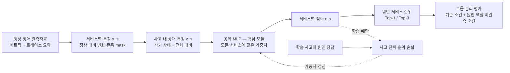

# MLP 중심 연구: 방향 점수화와 방법론 재설계

2026-10-12. 사용자는 연구의 핵심을 MLP로 둘 것을 명시했다.
아래는 문헌과 기존 데이터 검수에 근거한 **설계 제안**이다.
MLP 학습·성능 평가·신규성 입증은 아직 수행하지 않았다.

## 1. 먼저 바로잡을 판단

이전 실험은 규칙 점수기와 LLM 입력 조건을 비교했으며 **MLP를 학습하지 않았다.**
따라서 LLM의 낮은 점수를 MLP의 부적합 근거로 사용하면 안 된다.
100점 상한·동점 문제는 공통 입력과 기준점의 검증 항목이지 MLP 연구를 대신하는 주제가 아니다.

판정은 다음 두 층위로 나눈다.
- **MLP를 원인 서비스 순위 모듈로 사용하는 것:** 충분히 검토할 만하다.
- **MLP를 사용했다는 사실이 논문 기여인가:** 아니다. 직접적인 선행 방법이 이미 있다.

## 2. 후보 방향의 점수

각 기준을 0~5점으로 평가하고 가중 합을 100점으로 환산했다.
이것은 문헌·데이터·설계 제약에 대한 **전문가 판단 점수**이며 모델 정확도,
통계적 확률, 논문 채택 가능성이 아니다.

| 기준 | 가중치 | 판단 내용 |
|---|---:|---|
| 문제 근거 | 25 | 구체적인 실패/구조적 한계가 문헌과 데이터에서 뒷받침되는가 |
| 데이터 적합성 | 25 | 필요한 입력과 학습·평가 정답이 있는가 |
| 차별성 가능성 | 20 | 기존 방법과 구분할 연구 질문·기제가 있는가 |
| 평가 가능성 | 20 | MLP의 기여를 공정하게 분리하여 반증할 수 있는가 |
| 구현 현실성 | 10 | 현재 표본·자원·개발 범위에서 최소 실험이 가능한가 |

`총점 = Σ(등급 / 5 × 가중치)`.
0은 현재 근거/조건 부재, 1은 심한 결함·직접 중복, 2는 약한 근거,
3은 부분적으로 뒷받침, 4는 강한 근거지만 제한 존재, 5는 해당 단계에서 조건이 잘 맞음을 뜻한다.
데이터 5점도 충분한 통계 검정력이나 운영 일반화를 보장하지 않는다.

| 방향 | 문제 | 데이터 | 차별성 | 평가 | 현실성 | 총점 | 판단 |
|---|---:|---:|---:|---:|---:|---:|---|
| MLP 전파 방향 예측 → LLM | 2 | 1 | 1 | 2 | 2 | **31** | 현재 데이터로 본 방법 추진 보류 |
| MLP로 관계 선별 → LLM | 2 | 2 | 1 | 3 | 2 | **40** | 학습 정답·유용성 정의와 두 모듈 효과가 불명확 |
| 일반 MLP로 원인 서비스 분류 | 2 | 5 | 1 | 5 | 5 | **69** | 중요한 기준점이지만 그대로는 차별성 부족 |
| 서비스 신원 의존을 줄인 상대 특징 MLP 순위화 | 4 | 4 | 2 | 4 | 4 | **72** | **우선 검증할 연구 후보**, 논문 주제 확정은 아님 |

### 점수의 근거
- **방향 예측:** RCAEval에는 원인 서비스 정답만 있고 전파 연결·방향 정답은 없다.
  ops-lite는 출처/버전·정답 신뢰성 조건이 미확정이다. LLM이 최종 판단하면 MLP의
  방향 예측 개선과 진단 개선을 별도로 검증해야 한다.
- **관계 선별:** 원인 정답으로 유용한 선택을 약하게 학습하는 설계는 가능하지만,
  미표기 연결을 음성으로 삼을 수 없고 구체적인 목적함수가 아직 없다.
  MicroHECL·EviRCA·TopoEvo 등과의 겹침도 크다.
- **일반 분류:** root-service 정답과 Top-k 평가가 잘 맞고 만들기 쉽다.
  그러나 DiagMLP가 직접적인 선행 방법이므로 MLP 사용 자체는 새 기여가 아니다.
- **상대 특징 순위화:** DiagMLP의 고정 노드 위치·전체 노드 연결 표현은 문헌에 명시된
  구조적 특성이며 가변 후보/변경된 원인 역할을 평가할 이유가 있다. 현재 root 정답으로
  순위 학습은 가능하다. 다만 작은 표본, 서비스 신원의 간접 부호화, 유사 순위기 선행법,
  새로운 평가 조건의 표본 부족 때문에 차별성 2점에 그친다.

**72와 69의 3점 차이는 확정적인 우열이 아니다.** 한 항목의 등급을 한 단계 바꾸면
총점이 2~5점 움직인다. 일반 MLP 기준점을 먼저 만들고 이를 확장해 두 방향을 함께 검증하는
것이 합리적이다. 점수가 높아도 핵심 정답 부재나 신규성 미확립을 상쇄할 수 없다.
현재 어느 방향도 ‘출판 가능한 신규성이 검증된 주제’라는 관문을 통과하지 않았다.

## 3. 추가 확인한 가장 가까운 선행 연구

### DiagMLP: 직접 비교해야 할 방법

*Are GNNs Actually Effective for Multimodal Fault Diagnosis in Microservice Systems?*
— ICWS 2025, pp.127–129로 DOI 서지 정보를 확인했다 [1].
방법 세부사항은 공개된 arXiv v2 [2]를 읽었다. 최종 출판판 전체와의 동일성까지
대조한 것은 아니다.

- **배경:** 다중 관측자료 RCA에서 GNN이 널리 사용되지만, 전처리·임베딩·학습 모듈의
  효과가 함께 바뀌어 그래프 모듈 자체의 이득을 구분하기 어렵다.
- **방법:** 전처리와 하위 과제를 유지하고 GNN을 MLP로 대체한다.
  노드별 모달리티와 학습 가능한 위치 임베딩을 결합한 후,
  전체 노드 표현을 순서대로 연결해 Node-Fusion MLP에 입력한다.
- **결론:** 다섯 데이터셋에서 MLP가 경쟁력 있는 결과를 보였다고 보고한다.
  이는 MLP가 합리적인 선택임을 뒷받침하지만 모든 GNN이 불필요하다는 증명은 아니다.
- **이번 연구의 차별성 부담:** “복잡한 GNN 대신 MLP”라는 기여는 이미 존재한다.
  원문은 전체 노드 연결 방식의 파라미터가 노드 수에 비례하고,
  DeepSets/Set Transformer 같은 확장 가능 대안을 후속 방향으로 직접 언급한다.
  따라서 공유 MLP·순서 불변 구조만으로도 신규성을 주장할 수 없다.
- **주의:** 공개 원고의 일부 표·본문 수치에 정합성 의문이 있어 높은 점수 자체를
  우리 방법의 성능 근거로 가져오지 않는다. 여기서는 구조·통제 설계의 존재를 근거로 사용한다.
  논문 연결 Eadro fork의 공개 존재는 API로 확인했지만 DiagMLP 전체 실행은 검증하지 않았다.

### Eadro: 문제 배경과 비교 평가의 근거

Eadro(ICSE 2023)는 로그·메트릭·트레이스의 정보가 상호 보완적임을 실제 TrainTicket
예시로 설명한다 [3]. 네트워크 문제는 지연에 나타나지만 CPU 문제는 같은 방식으로
나타나지 않을 수 있다. 모달리티별 표현과 GAT를 결합하고 원인 서비스 순위를 출력한다.

이는 ‘다양한 관측을 결합하여 원인을 순위화한다’는 문제의 타당성을 뒷받침한다.
그러나 다중 관측 결합이나 완전연결층으로 서비스 확률을 출력하는 것 자체는 기존 기법이다.
Eadro는 탐지와 진단의 공동 학습도 수행하므로, 알려진 장애 구간의 진단만 비교하는
우리 설정과 구분해야 한다.

### 최근 RCAEval 통제 연구: 모델이 실제로 무엇을 학습했는가?

*Does Graph Structure Earn Its Place in Microservice Root-Cause Analysis?*는
2026년 프리프린트이며 탐색적 결과와 한계를 명시한다 [4].
MLP/그래프 모델 비교에서 특징·용량·학습 조건과 서비스별 원인 빈도의 영향을 구분한다.

이 논문은 사고 내 상대/순위 특징과 서비스 prior·교차 시스템 평가까지 다루므로,
“상대 특징을 쓴다”나 “서비스 신원 영향을 검사한다”는 발상도 최초라고 할 수 없다.
공개 artifact의 실행은 이번에 검증하지 않았고, 보고된 정확도를 우리 자료의 사실로
옮기지 않는다. 다만 매우 가까운 연구이므로 차별성 조사에서 제외해서는 안 된다.

## 4. 논문적으로 서술할 연구 배경과 문제

### 배경

마이크로서비스의 장애는 한 서비스의 자원·실행 상태 변화와 여러 서비스 사이의 호출 지연·
오류로 함께 관측된다. 서로 다른 장애 유형은 서로 다른 관측자료에 나타나므로, 한 종류의
지표나 이상 크기 하나만으로 원인을 일관되게 판단하기 어렵다. Eadro는 실제 벤치마크
관측을 통해 이러한 모달리티 간 상호 보완성을 설명했고, 기존 RCA는 이 정보를 결합해
원인 서비스 순위를 산출하는 방향으로 발전했다 [3].

그러나 높은 진단 성능이 복잡한 모델 자체의 기여를 뜻하지는 않는다. DiagMLP는 동일한
전처리·임베딩을 유지한 MLP 대체 실험으로 이 점을 제기했다 [2]. 따라서 MLP 연구는
모델 이름을 새롭게 제시하는 대신, 어떤 관측을 어떤 방식으로 결합해야 진단이 개선되는지
통제된 비교로 설명해야 한다.

동시에 일부 학습 구조는 서비스의 고정 위치나 전체 서비스 배열에 결합돼 있다.
DiagMLP의 위치 임베딩과 전체 노드 연결은 이 구조를 명시적으로 보여 준다 [2].
서비스 수와 구성이 변하면 입력·출력 계약을 조정해야 할 수 있고, 익숙한 서비스에 대한
좋은 진단이 학습 때 원인으로 등장하지 않은 서비스에도 유지되는지는 별개의 문제다.
서비스 이력은 유용한 정보일 수도 있으므로 이를 무조건 누출이나 잘못된 학습이라 부르지
않고, 현재 사고의 증거와 구분해 그 효용과 한계를 평가해야 한다 [4].

### 이번에 검증할 문제

> **고정 서비스 신원·배열에 결합된 판단 대신, 현재 사고의 서비스별 상태와 상대적인
> 변화 패턴을 공유 MLP로 평가하면, 학습 때 원인으로 보지 못한 서비스의 원인 순위도
> 안정적으로 추정할 수 있는가?**

이는 기존의 ‘전파 방향 예측기 → LLM’과 **다른 역할 정의를 갖는 새 설계 제안**이다.
MLP는 방향/관계 라벨 예측기가 아니라 최종 원인 서비스 순위 모듈이 된다.

현재 직접 확인된 것은 고정 위치 구조의 존재, 데이터의 root 정답과 소수의 주입 대상,
우리 기준점의 점수 포화 문제다. **현재 우리 MLP가 서비스 신원에 과적합했다거나
일반화에 실패했다는 로컬 실험 결과는 아직 없다.** 이를 검증할 가설로 둔다.
앞선 6건의 동점 오답을 이 새로운 문제의 경험적 증거로 재사용하지 않는다.

## 5. 구체적인 방법론

### 5.1 입력과 특징
- 한 사고의 정상/장애 메트릭과 관측 가능한 트레이스 요약을 서비스별로 정리한다.
- 서비스 이름·파일명·장애 유형 정답·고정 위치 임베딩은 MLP 특징에 넣지 않는다.
  서비스 식별자는 관측자료 결합 및 최종 출력 매핑에만 사용한다.
- CPU·메모리·지연·오류·호출량 등의 정상 대비 변화와 지속성, 유효 관측 수를 고정 차원
  벡터 `x_s`로 만든다. 공통 지표 계열과 단위·정규화 규칙을 먼저 동결한다.
- 점수를 모두 100으로 자르지 않는다. 필요하면 순서를 보존하는 signed-log 변환을
  사용하되 수치 안정화 규칙과 학습 구간에서 구한 파라미터를 명시한다.
- 결측은 값과 별도의 mask로 전달한다. 결측 0과 정상 상태를 동일시하지 않는다.

### 5.2 사고 내 상대 특징

같은 사고에서 관측 가능한 서비스들의 특징을 요약한 `c`를 만든다.
예를 들어 지표별 유효 관측만을 대상으로 평균을 계산한다.
전체가 결측인 항목은 요약의 결측 mask도 유지한다.

`z_s = [x_s, x_s - c, observation_mask_s, context_mask]`.

이 단계는 “같은 CPU 변화라도 다른 서비스와 비교했을 때 어떤 상태인가”라는 정보를 제공한다.
이는 **사고 내 대비 특징**이지 인과 전파 정답이나 원인 증명은 아니다.
호출 이웃 특징은 첫 핵심 모델에 필수로 넣지 않고, 필요성이 확인되면 별도 추가 실험으로 둔다.

### 5.3 핵심 MLP와 학습

모든 서비스에 동일한 MLP 가중치를 적용한다.

`r_s = MLP_theta(z_s)`  
`p_s = exp(r_s) / Σ_j exp(r_j)`  
`L_incident = -log(p_true_root)`

- 출력은 서비스마다 하나의 원인 점수이며, 내림차순으로 정렬한다.
- `p_s`는 사고 내 정규화 점수다. 별도 보정 없이 실제 원인 확률로 보장하지 않는다.
- 학습 정답은 사고의 root-service 하나다. edge·방향·피해 서비스 라벨을 만들지 않는다.
- 각 사고를 하나의 손실 단위로 평균한다. 서비스 행 수가 많은 시스템이 그만큼
  독립 학습 사례를 더 제공한다고 계산하지 않는다.
- 시작 구조 예: `입력 → 32 → 16 → 1`, ReLU·weight decay·검증 기반 early stopping.
  이것은 미검증 초기 설계값이며, 층 수 자체를 기여로 내세우지 않는다.

### 5.4 방법 도식

LLM은 이 핵심 경로에 없다. 추후 설명 기능을 붙이더라도 별도 목표·검증으로 다룬다.

## 6. 반증 가능한 가설

| 가설 | 직접 비교 | 기각·축소 조건 |
|---|---|---|
| H1: 비선형 결합이 유용하다 | 동일 상대 특징의 선형 점수기 ↔ 공유 MLP | 선형과 차이가 없으면 MLP 비선형성의 기여를 주장하지 않음 |
| H2: 사고 내 대비가 유용하다 | 동일 MLP의 로컬 특징만 ↔ 로컬+상대 특징 | 전처리/용량 통제 후 차이가 없으면 상대 특징을 핵심 기여에서 제외 |
| H3: 원인 역할이 바뀌는 조건에서 견고하다 | 학습에 원인으로 등장한 서비스 조건 ↔ 등장하지 않은 서비스 조건 | 후자에서 수정된 수치·공유 로컬 MLP 대비 이점이 없으면 일반화 주장을 기각 |

입력 순열에 대한 출력 대응은 공유 MLP/집합 요약의 **구현 불변식**이다.
이미 보장된 불변식을 만족시키는 추가 손실을 만들어 새로운 학습 기제처럼 포장하지 않는다.
후보 수가 달라도 실행된다는 성질도 정확도 유지나 새로운 서비스 일반화를 자동 보장하지 않는다.

## 7. 비교 방법과 평가 지표

### 비교 대상
1. 포화·동점 문제를 점검한 기존 수치 기준점.
2. 동일 특징의 선형 점수기: 비선형성 효과 통제.
3. 로컬 특징만 쓰는 공유 MLP: 상대 특징 효과 통제.
4. 상대 특징 공유 MLP: 제안 후보.
5. **DiagMLP:** 가장 가까운 문헌 기준점. 원문대로 구현/어댑터를 검증하고
   동일 전처리·임베딩 조건을 맞춘다. 일반 MLP를 임의로 DiagMLP라고 부르지 않는다.
6. 진단용으로 **학습 구간의 서비스별 원인 빈도만 쓰는 prior**를 추가한다.
   이는 합법적인 과거 이력 기준점이며, 시험 정답을 사용하면 누출이다.

처음부터 모든 논문을 동시에 재현하지 않는다. 최소 선형/로컬 MLP/상대 MLP와
수치 기준점으로 학습 파이프라인을 점검한 후 DiagMLP의 공정한 대조를 완성한다.
그래프 정보를 기여로 주장할 때만 동일 특징의 그래프·이웃 없는 통제도 추가한다.

### 지표
- **주지표:** 원인 서비스 Top-1 정확도. 기존 조건과 원인 역할 미관측 조건을 분리한다.
- **보조:** Top-3, MRR, 시스템/장애 유형별 결과, 추론 시간·학습 비용.
- **진단:** 서비스 prior 대비 이득, 순위의 ID/순열 민감도, 정적 mask만으로 예측되는 정도.
- 고정 후보 일부만 반복해서 원인이 되는 자료에서는 Top-5가 높아도 관측 증거를 잘
  해석했다는 뜻이 아닐 수 있다. Top-5만을 주지표로 쓰지 않는다.
- 단일 원인 Top-1 문제에서 F1을 추가해 같은 사실을 여러 지표로 포장하지 않는다.
- 전파 edge-F1·path accuracy는 현재 목표와 정답에 맞지 않아 사용하지 않는다.

### 분할과 공정성
- 같은 사고의 모든 서비스 행과 같은 주입 시나리오 반복은 같은 분할에 둔다.
- 원인 역할 미관측 조건은 특정 서비스의 **모든 원인 사고**를 학습에서 제외한다.
  해당 서비스가 정상/비원인으로 학습 입력에 나타날 수 있으므로 “완전히 새로운 서비스”라고
  부르지 않는다. 장애 유형 등 다른 차이가 함께 생기는지 별도 확인한다.
- DiagMLP에도 올바른 서비스-위치 매핑을 준다. 입력 배열만 잘못 섞어 실패를 유도하지 않는다.
- 정적 결측 패턴·지표 종류가 서비스 신원을 간접 부호화할 수 있다.
  이름을 지웠다는 이유만으로 신원 의존을 제거했다고 단정하지 않는다.
- 현재 180건/60반복 그룹은 작은 규모다. 서비스별 행을 늘려도 독립 사고 수는 늘지 않는다.
- 이미 사용한 개발 36건은 최종 시험에서 제외하고 보호된 144건을 열기 전에
  학습/검증/시험과 원인 역할 분리를 문서화한다. 이번 작업에서는 새 분할·학습을 실행하지 않았다.
- 동일 분할·동일 전처리·동일 학습 예산·반복 seed로 비교하고 그룹 단위 paired
  효과 크기·신뢰구간을 보고한다. 2개 시스템만으로 광범위한 시스템 일반화를 주장하지 않는다.

## 8. 노벨티와 기여의 정직한 구분

**이미 알려져 있으므로 신규성으로 쓰면 안 되는 것**
- RCA에 MLP를 적용한다.
- 모달리티를 결합한다.
- 서비스 점수를 순위화한다.
- 공유 MLP/집합 요약을 사용한다.
- 서비스 신원이나 그래프의 기여를 ablation으로 확인한다.

**입증된다면 기여 후보가 될 수 있는 것**
- 특정 운영 조건에서 기존 MLP 순위기의 실패를 체계적으로 재현하고 원인을 구분한다.
- 단순 기준·동일 용량 MLP·가까운 선행법으로 해결되지 않는 실패에 대응하는
  구체적인 특징/학습 기제가 있으며, 해당 기제의 제거가 이득을 없앤다.
- 엄격한 반복 그룹·원인 역할 분리에서 정확도 이득을 재현하고 비용을 제시한다.

이 목록은 **달성할 증명 의무**이지 확보된 기여가 아니다.
특히 [4]가 상대 특징·prior·전이 문제를 이미 다루므로 이 조합이 처음이라는 주장은 금지한다.
동일 연구가 이미 있거나 선형/기존 공유 MLP로 충분하면, 새 MLP 방법 논문으로 추진하지 않는다.

## 9. 이전에 안내한 순서의 재평가

‘기준점 실패를 확인하고 필요한 방법을 고른다’는 원칙은 타당했다.
그러나 **MLP 중심 조건을 놓치고 LLM의 실패를 연구 전체의 판단으로 확장한 점은 잘못**이다.
MLP를 한 번도 학습하지 않은 상태에서 MLP의 추가 가치를 기각할 수 없다.

수정된 순서는 다음과 같다.
1. MLP가 학습할 과제·정답·출력을 먼저 고정한다: 사고 내 root-service 순위화.
2. DiagMLP 등과 겹치는 부분과 검증할 특정 조건을 명시한다.
3. 점수 포화·정답 누출·반복 분할을 정리한 공통 전처리와 입력을 동결한다.
4. **선형/로컬 MLP/상대 MLP를 실제 학습하는 스모크**를 수행한다.
5. MLP 비선형성과 상대 특징의 효과를 분리하고, 원인 역할이 달라지는 조건을 평가한다.
6. 효과와 차별성이 모두 남을 때만 본 실험과 논문 기여로 확장한다.

즉, 점수 상한 제거가 새로운 연구 방향은 아니다. 그것은 공정한 MLP 실험의 준비 작업이다.
현재 추천은 72점 후보를 **MLP 중심의 다음 검증 설계**로 채택하는 것이며,
성공·신규성·최종 논문 주제를 확정하는 것이 아니다.

## 10. 출처와 이번에 하지 않은 것

[1] ICWS 2025 출판 DOI: https://doi.org/10.1109/ICWS67624.2025.00025  
[2] DiagMLP 공개 원고 v2, §III–IV: https://arxiv.org/html/2501.02766v2  
[3] Eadro, ICSE 2023, §III–IV: https://arxiv.org/html/2302.05092v1  
[4] 최근 RCAEval 통제 연구, 2026 프리프린트: https://arxiv.org/html/2609.27069v1  
[5] 현재 데이터·실험의 근거: `../데이터_확보_검수_보고서.md`,
`BASELINE_PROTOCOL.md`, `baselines/verification.json`, `연구_타당성_압박평가.md`.

새 MLP 학습, 기존 논문 수치 재현, 보호된 144건 관측자료 접근, 노션 수정은 하지 않았다.
점수표는 현재 근거로 방향을 비교한 판단이며 실험 결과가 아니다.
